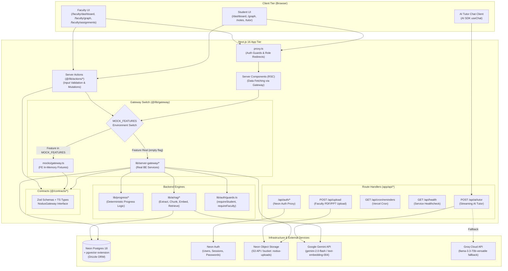
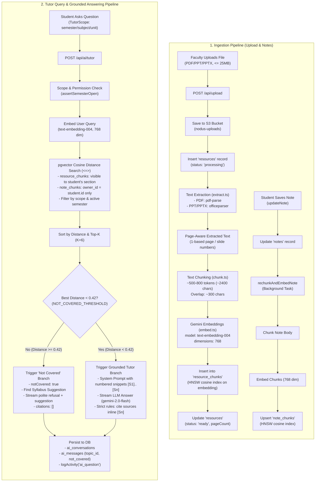
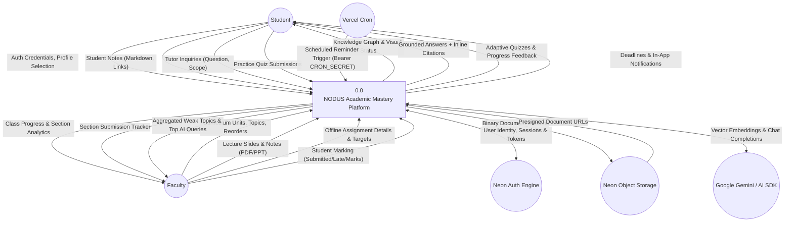
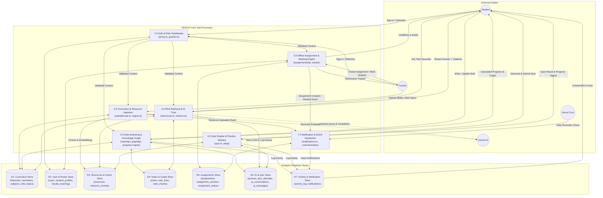
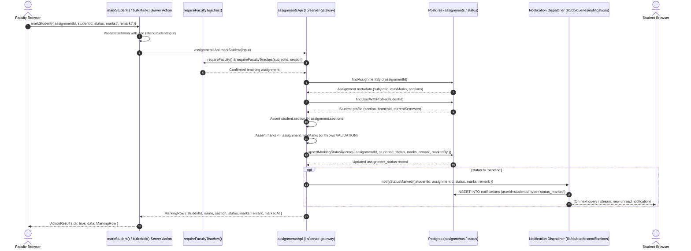
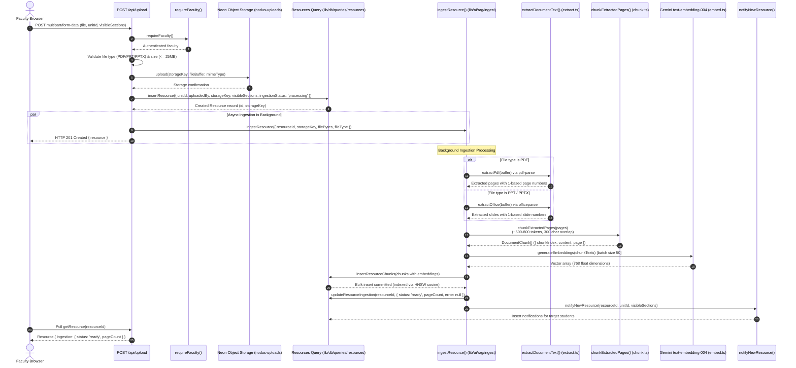

# NODUS — System Architecture

> Specification and architectural blueprint for the NODUS platform.
> Owner: **BE**.
> Referenced tasks: `BE-0.2`, `BE-0.4`, `BE-11.5`.

---

## 1. System Overview

NODUS is built on Next.js 16 (React 19 App Router) with a strict contract-driven, modular architecture. The application is decoupled between the Frontend (presentation, mock gateways, client stores) and the Backend (data layer, business logic, RAG engine, external integrations) via a shared Gateway interface.

### 1.1 Architectural Component Diagram



---

## 2. Gateway / Mock Pattern and File Ownership

### 2.1 The Gateway/Mock Architectural Pattern

To decouple Frontend and Backend velocities, NODUS uses a **contract-first, switchable gateway pattern**:

1. **Contracts as Single Source of Truth (`contracts/*`):**
   - Data models and payloads are declared using Zod schemas and TypeScript types.
   - The unified `NodusGateway` interface defines every domain method across 9 feature namespaces: `auth`, `curriculum`, `resources`, `notes`, `graph`, `ai`, `assignments`, `dashboard`, `notifications`.
2. **Dual Implementation:**
   - **Frontend Mocks (`mocks/gateway.ts`):** High-fidelity, deterministic in-memory fixtures implementing `NodusGateway`. FE builds complete UIs with zero waiting for DB or AI APIs.
   - **Backend Implementation (`lib/server-gateway/*`):** Real database queries (Drizzle), role permissions, AI services, and transaction logic implementing `NodusGateway`.
3. **Runtime Feature Switching (`lib/gateway/index.ts`):**
   - The frozen switcher inspects `process.env.MOCK_FEATURES`.
   - `MOCK_FEATURES=all`: Complete mock mode for isolated UI development.
   - `MOCK_FEATURES=graph,ai`: Only graph and AI use mocks; other domains use the real backend.
   - `MOCK_FEATURES=` (empty): Production mode — all 9 features run on the real backend.
4. **Server Actions as Mutation Boundaries (`lib/actions/*`):**
   - Actions receive inputs from client components, validate them against contract Zod schemas, execute `getGateway().<feature>.<method>()`, and return safe `ActionResult<T>` structures (`{ ok: true, data }` or `{ ok: false, error }`).
   - Exceptions never leak raw stack traces to the browser.

### 2.2 Strict Codebase Ownership

| Role | Owned Paths | Description |
|---|---|---|
| **BE** | `contracts/**`, `lib/server-gateway/**`, `lib/actions/**`, `lib/ai/**`, `lib/db/**`, `lib/progress/**`, `lib/auth/**`, `lib/storage/**`, `lib/env.ts`, `app/api/**`, `proxy.ts`, `neon.ts`, `drizzle.config.ts`, `scripts/**`, `.env.example`, `.github/**`, `docs/architecture.md`, `docs/database_schema.md`, `docs/api_contract.md`, `docs/progress_logic.md`, `docs/environment_setup.md`, `docs/test_cases_backend.md`, `docs/roadmap/BACKEND.md` | Data access, business logic, AI pipelines, API contracts, backend documentation. |
| **FE** | `app/**` (except `app/api/**`), `components/**`, `hooks/**`, `stores/**`, `mocks/**`, `public/**`, `docs/roadmap/FRONTEND.md`, `docs/user_flow.md`, `docs/ui_design.md`, `docs/test_cases.md` | Pages, UI components, client stores, visual styling, mock implementations. |
| **FROZEN** | `package.json`, `package-lock.json`, `next.config.ts`, `tsconfig.json`, `eslint.config.mjs`, `components.json`, `lib/gateway/index.ts`, `lib/utils.ts` | Shared configurations changed only via dedicated `chore/` PRs. |

> **ESLint Boundary Rule:** ESLint rules block all frontend code (`app/`, `components/`, `hooks/`, `stores/`) from directly importing `@/lib/db`, `@/lib/ai`, `@/lib/progress`, and `@/lib/server-gateway`. The frontend can only access backend capabilities via `@/contracts`, `@/lib/gateway`, `@/lib/actions`, and `@/lib/auth/client`.

---

## 3. RAG Pipeline Architecture (Ingestion & Query)

The Retrieval-Augmented Generation (RAG) pipeline is grounded strictly in two layers:
1. **Official Layer:** Faculty-uploaded lecture slides and notes (PDF/PPT/PPTX).
2. **Personal Layer:** The student's own private notes created under curriculum topics.

Internet sources and ungrounded LLM hallucinations are blocked by design.



---
## 4. Data Flow Diagrams (BE-0.4)

### 4.1 DFD Level 0 — Context Diagram



### 4.2 DFD Level 1 — Decomposed System Processes



---

## 5. Sequence Diagrams (BE-0.4)

### 5.1 Sequence 1: AI Tutor Streaming Question Flow

This sequence models `POST /api/ai/tutor`, `lib/ai/rag/retrieve.ts`, and the AI SDK UI message streaming pipeline.

```mermaid
sequenceDiagram
    autonumber
    actor Student as Student Browser
    participant API as POST /api/ai/tutor
    participant Guard as Auth & Scope Guard
    participant DB as Postgres (getDb)
    participant RAG as retrieveChunks()
    participant GeminiEmbed as Gemini text-embedding-004
    participant pgvector as Postgres (pgvector)
    participant GeminiChat as Gemini 2.0 Flash
    participant Activity as Activity & Chat Logger

    Student->>API: POST { messages, conversationId, scope }
    API->>Guard: requireStudent()
    Guard-->>API: OnboardedStudent context
    API->>Guard: assertSemesterOpen(scope)
    Guard-->>API: Validated (or throws LOCKED / NOT_FOUND)

    API->>RAG: retrieveChunks({ student, scope, question, topK: 6 })
    RAG->>GeminiEmbed: generateEmbeddings([question])
    GeminiEmbed-->>RAG: queryEmbedding [768 floats]

    par Query Faculty Resource Chunks
        RAG->>pgvector: SELECT from resource_chunks <=> queryEmbedding<br/>WHERE visibleSections ? section AND open semester
        pgvector-->>RAG: Top matching resource chunks
    and Query Student's Private Note Chunks
        RAG->>pgvector: SELECT from note_chunks <=> queryEmbedding<br/>WHERE ownerId = student.id AND open semester
        pgvector-->>RAG: Top matching personal note chunks
    end

    RAG->>RAG: Sort merged chunks by cosine distance; Assign [S1]..[Sn]
    
    alt Best Distance >= 0.42 (Not Covered)
        RAG->>DB: findTopicSuggestion(student, question)
        DB-->>RAG: Suggested topic from syllabus (or null)
        RAG-->>API: { notCovered: true, citations: [], suggestion }
        API->>DB: ensureConversation() & insertAiMessage(user)
        API->>Student: createUIMessageStream({ notCovered: true, citations: [] })
        API->>Student: Stream refusal message + suggested syllabus topic
        API->>Activity: insertAiMessage(assistant) & logActivity('ai_question')
    else Best Distance < 0.42 (Covered)
        RAG-->>API: { notCovered: false, citations: [S1..Sn], chunks }
        API->>DB: ensureConversation() & insertAiMessage(user)
        API->>GeminiChat: streamText({ system: buildTutorSystemPrompt(chunks), messages: history })
        API->>Student: createUIMessageStream({ messageMetadata: { citations, notCovered: false } })
        
        loop Token Streaming
            GeminiChat-->>API: text-delta chunk
            API-->>Student: text-delta (e.g. "...as shown in [S1]...")
        end

        GeminiChat-->>API: Stream finish
        API->>Student: stream finish event
        API->>Activity: insertAiMessage(assistant, citations, topicId)
        API->>Activity: logActivity({ type: 'ai_question', refId: conversationId })
    end
```

### 5.2 Sequence 2: Faculty Offline Assignment Marking Flow

This sequence models `markStudent` / `bulkMark` in `lib/server-gateway/assignments.ts` and notification dispatching.



### 5.3 Sequence 3: Upload Ingestion Pipeline Flow

This sequence models `POST /api/upload`, `lib/storage`, `lib/ai/rag/ingest.ts`, text extraction, and pgvector embeddings generation.



---
