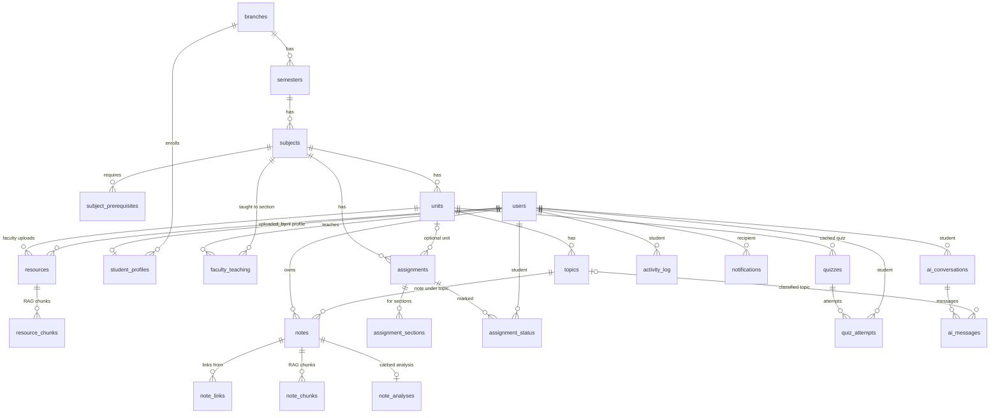

# NODUS — Database Schema

> **Owner: BE.** Source of truth: [`lib/db/schema/`](../lib/db/schema) (Drizzle). Migrations: [`lib/db/migrations/`](../lib/db/migrations).
> Postgres 18 on Neon · `pgvector` for embeddings · auth users live in Neon Auth's own `neon_auth` schema.

## 1. Overview

| Area | Tables |
|---|---|
| Curriculum | `branches`, `semesters`, `subjects`, `subject_prerequisites`, `units`, `topics` |
| People | `users`, `student_profiles`, `faculty_teaching` |
| Faculty material | `resources`, `resource_chunks` |
| Notes | `notes`, `note_links`, `note_chunks` |
| Assignments | `assignments`, `assignment_sections`, `assignment_status` |
| AI | `quizzes`, `quiz_attempts`, `ai_conversations`, `ai_messages`, `note_analyses` |
| Activity | `activity_log`, `notifications` |

**Conventions:** UUID primary keys · `created_at` / `updated_at` (timestamptz) on mutable tables · snake_case · enums mirror `contracts/`.

## 2. ER diagram

## 3. Tables

### Curriculum
| Table | Key columns | Notes |
|---|---|---|
| `branches` | `id`, `code` (unique), `name`, `sections text[]` | e.g. CSE, `{A,B,C}` |
| `semesters` | `id`, `branch_id`, `number` (1–8) | unique `(branch_id, number)` |
| `subjects` | `id`, `semester_id`, `code`, `name`, `order` | unique `(semester_id, code)` |
| `subject_prerequisites` | PK `(subject_id, prerequisite_subject_id)` | Dashed edges in Graph View (may cross semesters) |
| `units` | `id`, `subject_id`, `title`, `order` | |
| `topics` | `id`, `unit_id`, `title`, `order` | Faculty-defined; notes hang off topics |

### People
| Table | Key columns | Notes |
|---|---|---|
| `users` | `id` = **Neon Auth user id**, `email` (unique), `name`, `image`, `role` (`student`/`faculty`) | Auth owns credentials; NODUS owns role |
| `student_profiles` | PK `user_id`, `branch_id`, `current_semester`, `section` | Missing row → onboarding |
| `faculty_teaching` | PK `(faculty_id, subject_id, section)` | Scopes every faculty permission |

### Faculty material
| Table | Key columns | Notes |
|---|---|---|
| `resources` | `id`, `unit_id`, `uploaded_by`, `storage_key` (unique), `file_name`, `type`, `size_bytes`, `visible_sections text[]`, `ingestion_status`, `page_count`, `ingestion_error` | File lives in bucket `nodus-uploads` at `storage_key` |
| `resource_chunks` | `id`, `resource_id`, `chunk_index`, `content`, `page`, `embedding vector(768)` | HNSW index (cosine). `embedding` null until embedded |

### Notes (private)
| Table | Key columns | Notes |
|---|---|---|
| `notes` | `id`, `owner_id`, `topic_id` (**restrict** delete), `title`, `content_md`, `content_json`, `tags text[]`, `search_vector` (generated) | GIN indexes on `search_vector` and `tags` |
| `note_links` | `id`, `from_note_id`, `to_type` (`note`/`topic`/`unit`), `to_id` | Unique `(from, type, id)`; index `(to_type, to_id)` = backlinks |
| `note_chunks` | `id`, `note_id`, `chunk_index`, `content`, `embedding vector(768)` | HNSW index |

### Assignments (offline submission)
| Table | Key columns | Notes |
|---|---|---|
| `assignments` | `id`, `subject_id`, `unit_id?`, `title`, `description`, `due_at`, `max_marks`, `created_by` | |
| `assignment_sections` | PK `(assignment_id, section)` | Target sections |
| `assignment_status` | PK `(assignment_id, student_id)`, `status` (enum `assignment_mark`), `marks`, `remark`, `marked_by`, `marked_at` | **No row = pending** |

### AI
| Table | Key columns | Notes |
|---|---|---|
| `quizzes` | `id`, `unit_id`, `topic_id?`, `title`, `questions jsonb`, `source_hash` | Cached & shared per unit/topic |
| `quiz_attempts` | `id`, `quiz_id`, `student_id`, `score` (0–100), `answers jsonb`, `attempted_at` | Per-topic score = questions tagged with that topic |
| `ai_conversations` | `id`, `student_id`, `title`, `scope jsonb` | |
| `ai_messages` | `id`, `conversation_id`, `role`, `content`, `citations jsonb`, `not_covered`, `topic_id?` | `topic_id` powers faculty "most asked topics" (aggregated) |
| `note_analyses` | PK `note_id`, `content_hash`, `result jsonb` | Re-run only when the hash changes |

### Activity
| Table | Key columns | Notes |
|---|---|---|
| `activity_log` | `id`, `student_id`, `type`, `ref_id`, `created_at` | Heatmap + streak. Types: `note_created`, `note_updated`, `quiz_attempted`, `ai_question`, `resource_opened` |
| `notifications` | `id`, `user_id`, `type`, `title`, `body`, `target jsonb`, `read_at` | `read_at` null = unread |

## 4. Enums

| Enum | Values |
|---|---|
| `role` | student, faculty |
| `resource_type` | pdf, ppt, pptx |
| `ingestion_status` | processing, ready, failed |
| `link_target_type` | note, topic, unit |
| `assignment_mark` | pending, submitted, late, not_submitted |
| `chat_role` | user, assistant |
| `activity_type` | note_created, note_updated, quiz_attempted, ai_question, resource_opened |
| `notification_type` | resource_uploaded, assignment_created, deadline_reminder, status_marked |

> `assignment_mark` is not named `assignment_status` because Postgres already creates a row type named after the `assignment_status` table.

## 5. Migrations

| # | File | What |
|---|---|---|
| 0000 | `0000_enable-pgvector.sql` | `CREATE EXTENSION vector` |
| 0001 | `0001_core-schema.sql` | All tables, enums and indexes above |

Workflow: edit `lib/db/schema/*` → `npm run db:generate` → review the SQL → `npm run db:migrate` (direct connection, prints real errors).
