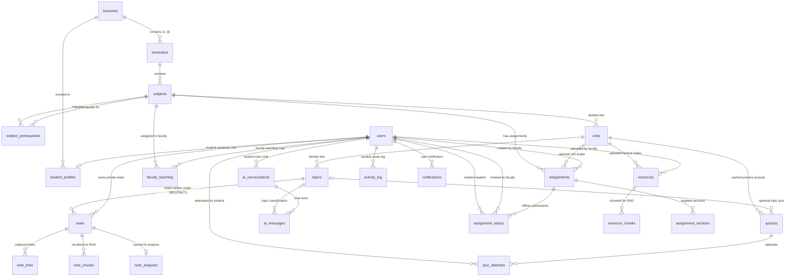

# NODUS — Database Schema & Data Dictionary

> **Owner: BE.** Source of truth: [`lib/db/schema/`](../lib/db/schema) (Drizzle ORM). Migrations: [`lib/db/migrations/`](../lib/db/migrations).
> PostgreSQL 18 on Neon · `pgvector` for vector embeddings (HNSW index, 768 dimensions) · Auth identities managed via Neon Auth (`neon_auth.user`).
> Referenced task: `BE-11.5`.

---

## 1. Architectural Overview & Conventions

The NODUS database is designed for academic integrity, high-performance RAG vector search, and student privacy:
- **Primary Keys:** UUID v4 for all tables via `defaultRandom()` (`id()`).
- **Audit Timestamps:** `created_at` and `updated_at` (timestamptz) automatically maintained on all mutable tables.
- **Strict Privacy Isolation:** Student notes, note links, and personal chat histories are private (`owner_id = student.id`). Faculty aggregations execute mathematical rollups only without exposing personal note content or private student questions.
- **Cascading & Integrity Rules:**
  - Topic deletion is protected: `notes.topic_id` specifies `onDelete: "restrict"`. Attempting to delete a topic that contains student notes triggers a `CONFLICT` error.
  - Cascade deletes are carefully bounded: deleting a subject/unit cascades resources, assignments, and curriculum hierarchies, while leaving user records intact.
- **Search & Vector Performance:**
  - Full-text search on student notes via PostgreSQL generated column `search_vector` (Title weighted `'A'`, body weighted `'B'`) indexed with GIN.
  - Vector cosine distance search on `resource_chunks` and `note_chunks` using `pgvector` with HNSW indexes (`vector_cosine_ops`).

---

## 2. Entity-Relationship Diagram

---

## 3. Data Dictionary & Table Schemas

### 3.1 Curriculum Subsystem (`lib/db/schema/curriculum.ts`)

#### `branches`
Represents degree branches (e.g., Computer Science & Engineering).
- `id` (uuid, PK, default: `gen_random_uuid()`): Branch identifier.
- `code` (text, NOT NULL, UNIQUE): Short identifier (e.g., `"CSE"`, `"IT"`).
- `name` (text, NOT NULL): Full department name.
- `sections` (text[], NOT NULL, default: `'{A,B,C}'::text[]`): Valid section letters offered for this branch.
- `created_at`, `updated_at` (timestamptz, NOT NULL).

#### `semesters`
Semesters 1 through 8 within an academic branch.
- `id` (uuid, PK): Semester identifier.
- `branch_id` (uuid, NOT NULL, FK → `branches.id` ON DELETE CASCADE): Parent branch.
- `number` (integer, NOT NULL, CHECK: `number BETWEEN 1 AND 8`): Semester sequence.
- `created_at`, `updated_at` (timestamptz, NOT NULL).
- **Constraints / Indexes:** UNIQUE `(branch_id, number)`.

#### `subjects`
Academic courses belonging to a specific semester.
- `id` (uuid, PK): Subject identifier.
- `semester_id` (uuid, NOT NULL, FK → `semesters.id` ON DELETE CASCADE): Parent semester.
- `code` (text, NOT NULL): Course code (e.g., `"CS201"`).
- `name` (text, NOT NULL): Course name (e.g., `"Data Structures & Algorithms"`).
- `order` (integer, NOT NULL, default: 0): Display order within semester.
- `created_at`, `updated_at` (timestamptz, NOT NULL).
- **Constraints / Indexes:** UNIQUE `(semester_id, code)`, INDEX `(semester_id, order)`.

#### `subject_prerequisites`
Directed dependency graph between subjects across the degree.
- `subject_id` (uuid, NOT NULL, FK → `subjects.id` ON DELETE CASCADE): Dependent subject.
- `prerequisite_subject_id` (uuid, NOT NULL, FK → `subjects.id` ON DELETE CASCADE): Required subject.
- **Constraints / Indexes:** PRIMARY KEY `(subject_id, prerequisite_subject_id)`.

#### `units`
Curriculum modules within a subject.
- `id` (uuid, PK): Unit identifier.
- `subject_id` (uuid, NOT NULL, FK → `subjects.id` ON DELETE CASCADE): Parent subject.
- `title` (text, NOT NULL): Unit title without `"Unit N - "` prefix (e.g., `"Graphs"`).
- `order` (integer, NOT NULL, default: 0): Unit sequence index.
- `created_at`, `updated_at` (timestamptz, NOT NULL).
- **Constraints / Indexes:** INDEX `(subject_id, order)`.

#### `topics`
Faculty-defined learning objectives within a unit.
- `id` (uuid, PK): Topic identifier.
- `unit_id` (uuid, NOT NULL, FK → `units.id` ON DELETE CASCADE): Parent unit.
- `title` (text, NOT NULL): Topic title (e.g., `"Dijkstra's Algorithm"`).
- `order` (integer, NOT NULL, default: 0): Display sequence index.
- `created_at`, `updated_at` (timestamptz, NOT NULL).
- **Constraints / Indexes:** INDEX `(unit_id, order)`.

---

### 3.2 People & Identity Subsystem (`lib/db/schema/users.ts`)

#### `users`
NODUS app profile linked 1:1 with Neon Auth credentials.
- `id` (uuid, PK): Equals Neon Auth user ID (`neon_auth.user.id`).
- `email` (text, NOT NULL, UNIQUE): User email address.
- `name` (text, NOT NULL): Full name.
- `image` (text, nullable): Avatar image URL.
- `role` (enum `role`, NOT NULL, default: `'student'`): `'student'` or `'faculty'`.
- `created_at`, `updated_at` (timestamptz, NOT NULL).

#### `student_profiles`
Academic placement metadata for students.
- `user_id` (uuid, PK, FK → `users.id` ON DELETE CASCADE): Associated student user.
- `branch_id` (uuid, NOT NULL, FK → `branches.id`): Enrolled branch.
- `current_semester` (integer, NOT NULL): Active semester (1–8).
- `section` (char(1), NOT NULL): Assigned cohort section (e.g., `'B'`).
- `created_at`, `updated_at` (timestamptz, NOT NULL).
- **Constraints / Indexes:** INDEX `(branch_id, current_semester, section)`.

#### `faculty_teaching`
Faculty-to-subject-section assignment permissions matrix.
- `faculty_id` (uuid, NOT NULL, FK → `users.id` ON DELETE CASCADE): Faculty user ID.
- `subject_id` (uuid, NOT NULL, FK → `subjects.id` ON DELETE CASCADE): Course taught.
- `section` (char(1), NOT NULL): Target section taught (e.g., `'A'`).
- **Constraints / Indexes:** PRIMARY KEY `(faculty_id, subject_id, section)`.

---

### 3.3 Faculty Resources & Vector Chunks (`lib/db/schema/resources.ts`)

#### `resources`
Uploaded faculty documents (lecture slides, notes, syllabi).
- `id` (uuid, PK): Resource identifier.
- `unit_id` (uuid, NOT NULL, FK → `units.id` ON DELETE CASCADE): Associated unit.
- `uploaded_by` (uuid, NOT NULL, FK → `users.id`): Faculty user ID who uploaded the file.
- `storage_key` (text, NOT NULL, UNIQUE): Object path in S3 bucket `nodus-uploads`.
- `file_name` (text, NOT NULL): Original filename (e.g., `"Unit3_Graphs.pdf"`).
- `type` (enum `resource_type`, NOT NULL): `'pdf'`, `'ppt'`, or `'pptx'`.
- `size_bytes` (integer, NOT NULL): File size in bytes (max 25 MB).
- `visible_sections` (text[], NOT NULL): Permitted sections (e.g., `{"A", "B"}`).
- `ingestion_status` (enum `ingestion_status`, NOT NULL, default: `'processing'`): `'processing'`, `'ready'`, or `'failed'`.
- `page_count` (integer, nullable): Number of pages or slides.
- `ingestion_error` (text, nullable): Failure diagnostic message if ingestion failed.
- `created_at`, `updated_at` (timestamptz, NOT NULL).
- **Constraints / Indexes:** INDEX `(unit_id)`.

#### `resource_chunks`
Extracted and vector-embedded text chunks from faculty resources.
- `id` (uuid, PK): Chunk identifier.
- `resource_id` (uuid, NOT NULL, FK → `resources.id` ON DELETE CASCADE): Parent resource.
- `chunk_index` (integer, NOT NULL): Sequence order within document.
- `content` (text, NOT NULL): Chunk text (~500–800 tokens).
- `page` (integer, nullable): 1-based page number (PDF) or slide number (PPT).
- `embedding` (vector(768), nullable): Gemini `text-embedding-004` vector.
- `created_at` (timestamptz, NOT NULL, default: `now()`).
- **Constraints / Indexes:** INDEX `(resource_id, chunk_index)`, HNSW INDEX `(embedding vector_cosine_ops)`.

---

### 3.4 Student Notes & Private Knowledge Graph (`lib/db/schema/notes.ts`)

#### `notes`
Private student notes authored under curriculum topics.
- `id` (uuid, PK): Note identifier.
- `owner_id` (uuid, NOT NULL, FK → `users.id` ON DELETE CASCADE): Note owner.
- `topic_id` (uuid, NOT NULL, FK → `topics.id` ON DELETE RESTRICT): Topic foreign key. Restricted to prevent orphaned notes.
- `title` (text, NOT NULL, default: `'Untitled'`): Note title.
- `content_md` (text, NOT NULL, default: `''`): Markdown representation.
- `content_json` (jsonb, nullable): Optional Tiptap rich-text AST.
- `tags` (text[], NOT NULL, default: `'{}'::text[]`): Note tags.
- `search_vector` (tsvector, generated always as `setweight(to_tsvector('english', coalesce(title, '')), 'A') || setweight(to_tsvector('english', coalesce(content_md, '')), 'B')`): Generated full-text vector.
- `created_at`, `updated_at` (timestamptz, NOT NULL).
- **Constraints / Indexes:** INDEX `(owner_id, topic_id)`, INDEX `(owner_id, updated_at)`, GIN INDEX `(search_vector)`, GIN INDEX `(tags)`.

#### `note_links`
Bidirectional links between notes, topics, and units stored by UUID.
- `id` (uuid, PK): Link identifier.
- `from_note_id` (uuid, NOT NULL, FK → `notes.id` ON DELETE CASCADE): Origin note.
- `to_type` (enum `link_target_type`, NOT NULL): `'note'`, `'topic'`, or `'unit'`.
- `to_id` (uuid, NOT NULL): Target entity UUID.
- `created_at` (timestamptz, NOT NULL, default: `now()`).
- **Constraints / Indexes:** UNIQUE `(from_note_id, to_type, to_id)`, INDEX `(to_type, to_id)` (powers backlinks queries).

#### `note_chunks`
Vector chunks extracted from private notes for personalized tutor RAG retrieval.
- `id` (uuid, PK): Note chunk identifier.
- `note_id` (uuid, NOT NULL, FK → `notes.id` ON DELETE CASCADE): Parent note.
- `chunk_index` (integer, NOT NULL): Chunk sequence index.
- `content` (text, NOT NULL): Chunk text content.
- `embedding` (vector(768), nullable): 768-dimensional embedding vector.
- `created_at` (timestamptz, NOT NULL, default: `now()`).
- **Constraints / Indexes:** INDEX `(note_id, chunk_index)`, HNSW INDEX `(embedding vector_cosine_ops)`.

---

### 3.5 Assignments Subsystem (`lib/db/schema/assignments.ts`)

#### `assignments`
Course assignments announced by faculty for offline submission.
- `id` (uuid, PK): Assignment identifier.
- `subject_id` (uuid, NOT NULL, FK → `subjects.id` ON DELETE CASCADE): Associated subject.
- `unit_id` (uuid, nullable, FK → `units.id` ON DELETE SET NULL): Optional unit scope.
- `title` (text, NOT NULL): Assignment title.
- `description` (text, NOT NULL, default: `''`): Assignment instructions and guidelines.
- `due_at` (timestamptz, NOT NULL): Submission deadline.
- `max_marks` (integer, nullable): Maximum score attainable.
- `created_by` (uuid, NOT NULL, FK → `users.id`): Authoring faculty user ID.
- `created_at`, `updated_at` (timestamptz, NOT NULL).
- **Constraints / Indexes:** INDEX `(subject_id, due_at)`.

#### `assignment_sections`
Target sections for which the assignment is due.
- `assignment_id` (uuid, NOT NULL, FK → `assignments.id` ON DELETE CASCADE).
- `section` (char(1), NOT NULL): Target section letter.
- **Constraints / Indexes:** PRIMARY KEY `(assignment_id, section)`.

#### `assignment_status`
Offline submission marking ledger. Absence of a record implies `'pending'`.
- `assignment_id` (uuid, NOT NULL, FK → `assignments.id` ON DELETE CASCADE).
- `student_id` (uuid, NOT NULL, FK → `users.id` ON DELETE CASCADE): Marked student.
- `status` (enum `assignment_mark`, NOT NULL): `'pending'`, `'submitted'`, `'late'`, `'not_submitted'`.
- `marks` (real, nullable): Marks awarded.
- `remark` (text, nullable): Faculty feedback remark.
- `marked_by` (uuid, nullable, FK → `users.id`): Faculty member who marked the submission.
- `marked_at` (timestamptz, NOT NULL, default: `now()`).
- **Constraints / Indexes:** PRIMARY KEY `(assignment_id, student_id)`, INDEX `(student_id)`.

---

### 3.6 AI, Quizzes & Tutor History (`lib/db/schema/ai.ts`)

#### `quizzes`
Generated practice quizzes cached per unit/topic from faculty slides.
- `id` (uuid, PK): Quiz identifier.
- `unit_id` (uuid, NOT NULL, FK → `units.id` ON DELETE CASCADE): Unit scope.
- `topic_id` (uuid, nullable, FK → `topics.id` ON DELETE CASCADE): Topic scope if focused.
- `title` (text, NOT NULL): Quiz title.
- `questions` (jsonb, NOT NULL): Serialized array of `QuizQuestion` objects.
- `source_hash` (text, nullable): Content hash of underlying source chunks for cache invalidation.
- `created_at` (timestamptz, NOT NULL, default: `now()`).
- **Constraints / Indexes:** INDEX `(unit_id, topic_id)`.

#### `quiz_attempts`
Student practice attempts and grading results.
- `id` (uuid, PK): Attempt identifier.
- `quiz_id` (uuid, NOT NULL, FK → `quizzes.id` ON DELETE CASCADE): Attempted quiz.
- `student_id` (uuid, NOT NULL, FK → `users.id` ON DELETE CASCADE): Attempting student.
- `score` (real, NOT NULL): Score percentage (0.0 to 100.0).
- `answers` (jsonb, NOT NULL): Array of selected answer indices `(number | null)[]`.
- `attempted_at` (timestamptz, NOT NULL, default: `now()`).
- **Constraints / Indexes:** INDEX `(student_id, attempted_at)`, INDEX `(quiz_id)`.

#### `ai_conversations`
Student chat sessions with the AI tutor.
- `id` (uuid, PK): Conversation identifier.
- `student_id` (uuid, NOT NULL, FK → `users.id` ON DELETE CASCADE): Owner student.
- `title` (text, NOT NULL): Conversation title.
- `scope` (jsonb, NOT NULL): `TutorScope` (`{ type: "semester" | "subject" | "unit", ... }`).
- `created_at`, `updated_at` (timestamptz, NOT NULL).
- **Constraints / Indexes:** INDEX `(student_id, updated_at)`.

#### `ai_messages`
Individual dialog turns, grounded citations, and topic classifications.
- `id` (uuid, PK): Message identifier.
- `conversation_id` (uuid, NOT NULL, FK → `ai_conversations.id` ON DELETE CASCADE).
- `role` (enum `chat_role`, NOT NULL): `'user'` or `'assistant'`.
- `content` (text, NOT NULL): Message body.
- `citations` (jsonb, NOT NULL, default: `'[]'::jsonb`): Grounded citations array (`Citation[]`).
- `not_covered` (boolean, NOT NULL, default: `false`): True if question fell outside syllabus materials.
- `topic_id` (uuid, nullable, FK → `topics.id` ON DELETE SET NULL): Best-matching topic ID (powers faculty aggregated analytics).
- `created_at` (timestamptz, NOT NULL, default: `now()`).
- **Constraints / Indexes:** INDEX `(conversation_id, created_at)`, INDEX `(topic_id)`.

#### `note_analyses`
Cached Analyze Note output (summary, tags, action items).
- `note_id` (uuid, PK, FK → `notes.id` ON DELETE CASCADE): Subject note.
- `content_hash` (text, NOT NULL): SHA-256 hash of `content_md`. Recomputed only upon content change.
- `result` (jsonb, NOT NULL): Analysis payload `{ summary, keyPoints, suggestedTags, missingConcepts, actionItems }`.
- `generated_at` (timestamptz, NOT NULL, default: `now()`).
- **Constraints / Indexes:** PRIMARY KEY `(note_id)`.

---

### 3.7 Activity & Notifications (`lib/db/schema/activity.ts`)

#### `activity_log`
Immutable study event stream powering the 180-day activity heatmap and study streaks.
- `id` (uuid, PK): Log entry identifier.
- `student_id` (uuid, NOT NULL, FK → `users.id` ON DELETE CASCADE): Student user.
- `type` (enum `activity_type`, NOT NULL): Event type (`'note_created'`, `'note_updated'`, `'quiz_attempted'`, `'ai_question'`, `'resource_opened'`).
- `ref_id` (uuid, nullable): Related entity ID.
- `created_at` (timestamptz, NOT NULL, default: `now()`).
- **Constraints / Indexes:** INDEX `(student_id, created_at)`.

#### `notifications`
In-app user notifications.
- `id` (uuid, PK): Notification identifier.
- `user_id` (uuid, NOT NULL, FK → `users.id` ON DELETE CASCADE): Recipient user.
- `type` (enum `notification_type`, NOT NULL): `'resource_uploaded'`, `'assignment_created'`, `'deadline_reminder'`, `'status_marked'`.
- `title` (text, NOT NULL): Header title.
- `body` (text, NOT NULL): Notification body text.
- `target` (jsonb, nullable): `NotificationTarget` metadata for navigation.
- `read_at` (timestamptz, nullable): Timestamp when opened/read (null = unread).
- `created_at` (timestamptz, NOT NULL, default: `now()`).
- **Constraints / Indexes:** INDEX `(user_id, created_at)`.

---

## 4. Enumerations Reference

| Enum Name | Postgres Identifier | Valid Enumeration Values |
|---|---|---|
| `roleEnum` | `role` | `student`, `faculty` |
| `resourceTypeEnum` | `resource_type` | `pdf`, `ppt`, `pptx` |
| `ingestionStatusEnum` | `ingestion_status` | `processing`, `ready`, `failed` |
| `linkTargetTypeEnum` | `link_target_type` | `note`, `topic`, `unit` |
| `assignmentStatusEnum` | `assignment_mark` | `pending`, `submitted`, `late`, `not_submitted` |
| `chatRoleEnum` | `chat_role` | `user`, `assistant` |
| `activityTypeEnum` | `activity_type` | `note_created`, `note_updated`, `quiz_attempted`, `ai_question`, `resource_opened` |
| `notificationTypeEnum` | `notification_type` | `resource_uploaded`, `assignment_created`, `deadline_reminder`, `status_marked` |

> *Note on Postgres Naming:* The assignment enum is named `assignment_mark` in Postgres to prevent naming collisions with the `assignment_status` table.

---

## 5. Migrations & Drizzle Kit Workflow

Migrations are generated and tracked in `lib/db/migrations/`:
1. `0000_enable-pgvector.sql`: Enables the PostgreSQL `vector` extension (`CREATE EXTENSION IF NOT EXISTS vector`).
2. `0001_core-schema.sql`: Instantiates all tables, foreign keys, check constraints, GIN full-text indexes, and HNSW vector cosine indexes.

**Developer Migration Commands:**
- `npm run db:generate`: Generates incremental SQL migrations from schema alterations in `lib/db/schema/`.
- `npm run db:migrate`: Applies pending migrations to the database branch specified by `DATABASE_URL_UNPOOLED` in `.env.local`.
- `npm run db:seed`: Seeds demo syllabus, realistic students, notes, quizzes, and assignments on dev branches.
- `npm run db:studio`: Launches Drizzle Studio GUI on `https://local.drizzle.studio`.

---
